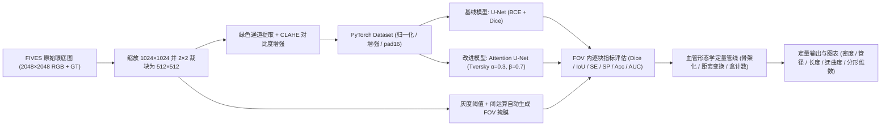
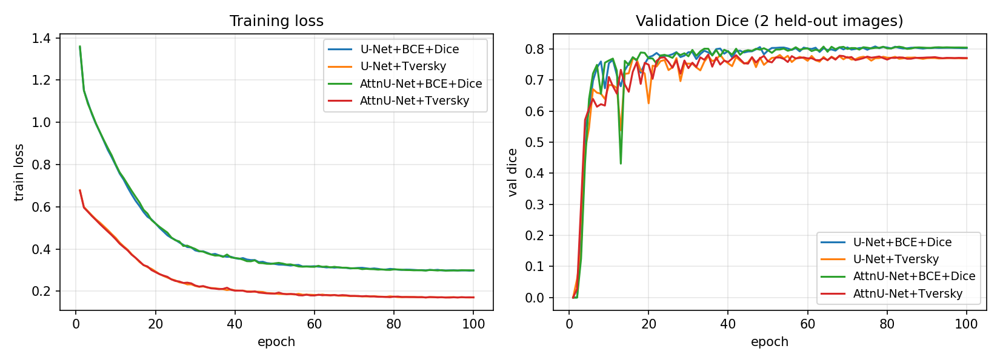
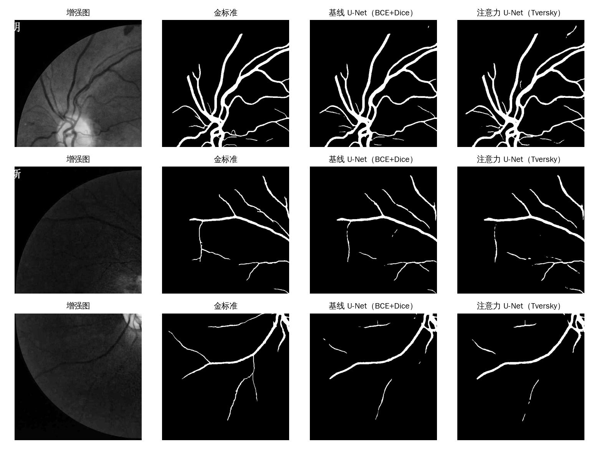
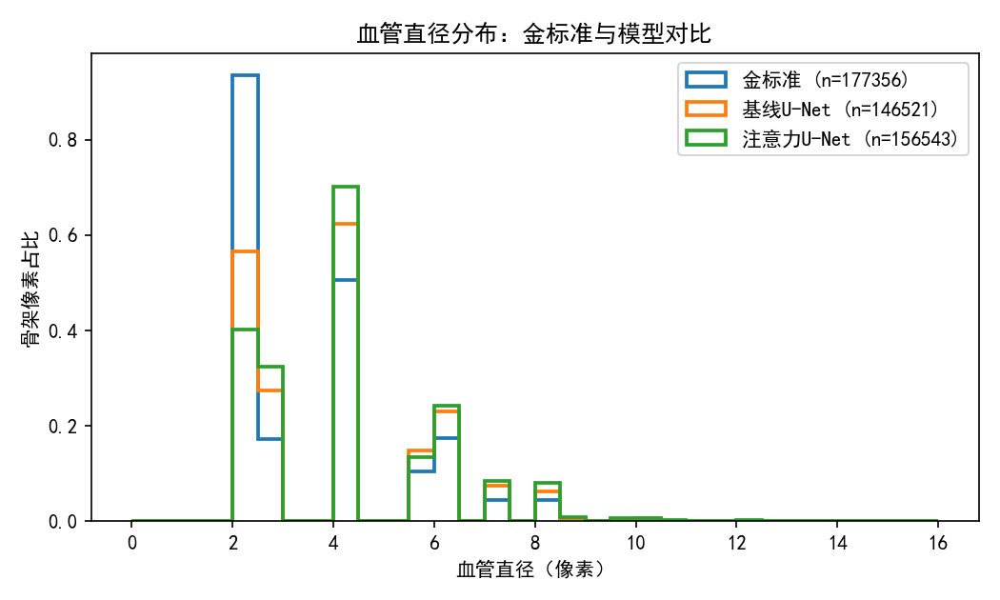

# 基于眼底图像的视网膜血管分割与血管形态特征分析

[](https://github.com/yunyancuo/retinal-vessel-segmentation/actions/workflows/ci.yml)
[](https://www.python.org/)
[](https://pytorch.org/)
[-1B6B7A)](https://huggingface.co/datasets/tyluan/FIVES)
[](https://docs.astral.sh/ruff/)

面向医学影像课程实践与科研复现的视网膜血管分割与形态定量分析工程：基于 **FIVES** 大规模眼底数据集（同时向后兼容 **DRIVE**），系统对比 **U-Net（BCE + Dice）** 与 **Attention U-Net（Tversky Loss）** 在分割精度与细小血管召回之间的权衡，并构建自动化血管骨架化与形态学定量管线（血管密度、直径分布、总长度、迂曲度、分形维数与拓扑关键点）。

---

## 核心特性

- **双模型与不平衡损失对比**：实现支持任意奇偶分辨率输入自动对齐的经典 `UNet` 与 `AttentionUNet`，内置数值稳定的 `BCE`、`Soft Dice`、`BCE + Dice` 与面向细血管高召回的 `Tversky (α=0.3, β=0.7)` 损失函数。
- **严谨的视野（FOV）内评测**：所有分割与形态学指标均严格在自动生成或专家标注的 FOV 有效视野内计算，杜绝黑边背景虚高准确率与特异性。
- **全套血管形态定量管线**：基于骨架提取（优先 `scikit-image`，轻量环境自动回退纯 NumPy Zhang-Suen 细化）与欧氏距离变换，自动计算血管密度、平均/中位管径、血管总长、端点/分叉点拓扑数、凸包加速迂曲度与盒计数分形维数。
- **跨平台工程化保障**：全链路兼容 Windows/Linux 中文路径图像读写，配套 `pyproject.toml`、`ruff` 静态检查、`pytest` 离线单元测试与 GitHub Actions CI 工作流。

---

## 算法与形态学分析流程



---

## FIVES 测试集关键实验结果（n = 800 块）

> 数据划分：FIVES 官方 600 张训练全图（2400 个 512×512 裁块，其中留出 120 块验证选最优权重）与 200 张测试全图（800 个 512×512 独立测试块）。两模型训练轮数（15 epochs）、批大小（4）、优化器（Adam, lr=1e-3, CosineAnnealingLR）与随机种子完全一致。

### 1. 像素级分割性能对比

| 评价指标 | 基线 U-Net（BCE + Dice） | 注意力 U-Net（Tversky α=0.3, β=0.7） | 差异解读 |
| :--- | :---: | :---: | :--- |
| **Dice** | **0.8713 ± 0.140** | 0.8575 ± 0.135 | 基线整体重叠度更高 |
| **IoU** | **0.7904 ± 0.153** | 0.7676 ± 0.146 | 与 Dice 趋势一致 |
| **敏感性 (SE)** | 0.8602 ± 0.156 | **0.8957 ± 0.150** | Tversky 带来 **+3.55%** 细血管召回提升 |
| **特异性 (SP)** | **0.9912 ± 0.006** | 0.9833 ± 0.009 | 基线背景误检更少 |
| **准确率 (Acc)** | **0.9824 ± 0.009** | 0.9783 ± 0.010 | 视野内总体像素准确率 |
| **ROC AUC** | **0.9900 ± 0.023** | 0.9708 ± 0.047 | `n=795`（跳过 5 个纯背景无血管块） |

### 2. 血管形态学定量对比（金标准 vs 模型预测）

| 形态学特征 | 专家金标准 (GT) | 基线 U-Net | 注意力 U-Net（Tversky） | 临床/算法观察 |
| :--- | :---: | :---: | :---: | :--- |
| **血管密度（视野内）** | 0.0937 | **0.0918** | 0.1019 | 基线与金标准最为接近 |
| **平均直径（像素）** | 6.67 | **6.92** | 7.24 | 预测倾向使细血管略微偏粗 |
| **中位直径（像素）** | 6.16 | **6.51** | 6.83 | 呈稳定单峰分布 |
| **血管总长度（像素/块）** | 2658 | 2461（92.6%） | **2629（99.0%）** | Tversky 显著缓解末梢断裂 |
| **迂曲度（简化口径）** | 3.92 | 3.36 | **3.53** | 细末梢召回提升缓解迂曲度低估 |
| **分形维数（盒计数）** | 1.394 | 1.376 | **1.394** | 改进模型精准保持血管分支复杂度 |

### 3. 实验可视化预览

| 训练曲线（Loss 与验证 Dice） | 测试块定性分割对比 | 血管直径分布对比 |
| :---: | :---: | :---: |
|  |  |  |

完整分析详见 [实验报告.md](实验报告.md)、[results/测试结果.md](results/测试结果.md) 以及定稿文档 [FIVES血管分割实验报告.pdf](FIVES血管分割实验报告.pdf)。

---

## 目录结构

```text
retinal-vessel-segmentation/
├── .github/workflows/ci.yml      # GitHub Actions 自动化 CI（Ruff + Pytest）
├── pyproject.toml                # 项目元数据、Ruff 规则与 Pytest 配置
├── requirements.txt              # Python 运行依赖清单
├── src/
│   ├── io_utils.py               # 跨平台中文路径图像读写工具（零 PyTorch 依赖）
│   ├── prepare_fives.py          # FIVES 数据准备：parquet → 1024 缩放 → 512 裁块 → CLAHE & FOV
│   ├── preprocess.py             # DRIVE 数据预处理：绿色通道 CLAHE、归一化与 PNG 导出
│   ├── dataset.py                # PyTorch Dataset：归一化 / 随机翻转旋转增强 / pad16
│   ├── models.py                 # UNet 与 AttentionUNet（内置任意奇偶尺寸跳跃连接对齐）
│   ├── losses.py                 # BCE / Soft Dice / BCE+Dice / Tversky 数值稳定实现
│   ├── train.py                  # 训练主脚本（CosineAnnealingLR + 验证最优权重保存）
│   ├── evaluate.py               # FOV 内指标评估（Dice/IoU/SE/SP/Acc/AUC）与 TP/FN/FP 可视化
│   ├── morphology.py             # 单图血管形态定量（骨架化 / 管径 / 拓扑关键点 / 迂曲度 / 分形维数）
│   ├── morphology_batch.py       # 批量形态学统计汇总与直径分布对比绘图
│   ├── plot_curves.py            # 训练损失与验证 Dice 平滑曲线绘制
│   ├── qualitative.py            # 增强图 / 金标准 / 多模型预测定性拼图
│   └── cn_font.py                # 跨平台 Matplotlib 中文字体配置
├── tests/
│   ├── test_io_and_preprocess.py # 图像读写、CLAHE 增强、归一化与 FIVES/DRIVE 预处理测试
│   ├── test_morphology.py        # 空掩膜、直线/弯曲/分叉/闭环血管形态与批量分析测试
│   ├── test_evaluate_and_plots.py# 分割指标、单类/并列分 AUC、误差着色图与日志读取测试
│   └── test_losses_and_models.py # 损失数值稳定性、奇偶尺寸前向与梯度、Dataset/Train 测试
├── data/README.md                # DRIVE 数据集目录结构与获取指引
├── outputs_fives/                # FIVES 实测训练日志、逐块评测与形态统计原始 CSV
├── results/                      # 测试结果摘要与逐块明细 CSV
├── figures/                      # 实验报告高清图表
├── report_build/                 # Word 实验报告自动化构建脚本与内容配置
├── 实验报告.md                    # Markdown 版完整实验报告
├── FIVES血管分割实验报告.docx      # Word 定稿实验报告
└── FIVES血管分割实验报告.pdf       # PDF 定稿实验报告
```

---

## 环境安装与复现指南

### 1. 安装依赖

建议使用 Python 3.10 及以上版本与虚拟环境：

```bash
python -m venv .venv
# Linux / macOS: source .venv/bin/activate
# Windows PowerShell: .venv\Scripts\Activate.ps1

pip install -r requirements.txt
# 如需运行本地静态检查与单元测试，请额外安装开发依赖：
pip install pytest ruff
```

### 2. 数据准备（FIVES）

从 Hugging Face 公开镜像 [tyluan/FIVES](https://huggingface.co/datasets/tyluan/FIVES) 下载 4 个 parquet 分片并放入 `data_src/` 目录，执行预处理：

```bash
python src/prepare_fives.py --src-dir data_src --out-dir data/FIVES/processed
```

> 如需使用 DRIVE 数据集，请参考 [data/README.md](data/README.md) 放置数据后运行 `python src/preprocess.py`。

### 3. 模型训练

```bash
# 训练基线 U-Net（BCE + Dice）
python src/train.py \
    --data-root data/FIVES/processed \
    --model unet --loss bce_dice \
    --epochs 15 --batch-size 4 --val-count 120 --seed 42 \
    --out-dir outputs/unet_bce_dice

# 训练改进 Attention U-Net（Tversky）
python src/train.py \
    --data-root data/FIVES/processed \
    --model attn_unet --loss tversky \
    --epochs 15 --batch-size 4 --val-count 120 --seed 42 \
    --out-dir outputs/attn_unet_tversky
```

### 4. 测试集评估与形态学定量分析

```bash
# FOV 内逐块评估与 TP/FN/FP 误差着色图导出
python src/evaluate.py \
    --data-root data/FIVES/processed \
    --weights outputs/unet_bce_dice/checkpoints/best.pth \
    --save-dir outputs/unet_bce_dice/predictions

python src/evaluate.py \
    --data-root data/FIVES/processed \
    --weights outputs/attn_unet_tversky/checkpoints/best.pth \
    --save-dir outputs/attn_unet_tversky/predictions

# 批量血管形态特征定量对比（金标准 vs 基线 vs 改进版）
python src/morphology_batch.py \
    --sources 金标准=data/FIVES/processed/test/masks \
              基线U-Net=outputs/unet_bce_dice/predictions/test \
              注意力U-Net=outputs/attn_unet_tversky/predictions/test \
    --fov-dir data/FIVES/processed/test/fov \
    --out-dir outputs/morphology

# 绘制训练曲线对比图
python src/plot_curves.py \
    --logs outputs/unet_bce_dice/train_log.csv outputs/attn_unet_tversky/train_log.csv \
    --names "U-Net (BCE+Dice)" "Attention U-Net (Tversky)" \
    --out outputs/figures/train_curves.png
```

---

## 测试与代码质量检查

本项目内置不依赖外部大型数据集的离线单元测试套件，覆盖预处理、形态学定量、评价指标与 PyTorch 网络/损失模块：

```bash
# 静态代码检查
ruff check src tests

# 运行全部离线单元测试（若本机未安装 PyTorch，torch 相关用例会自动安全跳过）
pytest -v
```

---

## 参考文献

1. Jin K., Huang X., Zhou J., et al. *FIVES: A Fundus Image Dataset for Artificial Intelligence based Vessel Segmentation*. Scientific Data, 2022.
2. Ronneberger O., Fischer P., Brox T. *U-Net: Convolutional Networks for Biomedical Image Segmentation*. MICCAI, 2015.
3. Oktay O., Schlemper J., Le Folgoc L., et al. *Attention U-Net: Learning Where to Look for the Pancreas*. MIDL, 2018.
4. Salehi S. S. M., Erdogmus D., Gholipour A. *Tversky Loss Function for Image Segmentation Using 3D Fully Convolutional Deep Networks*. MLMI, 2017.
